

  

<h1 align="center">Hi, I'm Kasymbek.</h1>

<strong>Software Developer · Mobile, Desktop &amp; Web</strong>

  I turn ideas into applications people can use. 
  Kotlin interfaces, web experiences and the APIs that connect them.

  
  &nbsp;
  

  

I’m **Kasymbek Talasbek**. With **[KDvibers](https://github.com/KDvibers)**, I work on tools for focused work, discovering hackathons and making AI results easier to review. My part spans **interfaces, API integration and preparing applications to run**.

## Selected work

<a href="https://github.com/KDvibers/FocusDuo">
  
</a>

**[FocusDuo](https://github.com/KDvibers/FocusDuo)** brings two people into a shared focus session, with a synchronized timer, personal goals and session history. **My contribution:** desktop application work and the Windows installer.

[Code ↗](https://github.com/KDvibers/FocusDuo) &nbsp; · &nbsp; [Download for Windows ↗](https://github.com/KDvibers/FocusDuo/releases/tag/v0.1.0)

Inside FocusDuo · stack &amp; release

- **Desktop:** Kotlin · Compose Desktop
- **Team backend:** Java · Spring Boot · PostgreSQL
- **Integration:** REST · WebSocket
- **Release:** Windows v0.1.0; the installer is available in GitHub Releases.

 

<a href="https://github.com/KDvibers/HackAtlas">
  
</a>

**[HackAtlas](https://github.com/KDvibers/HackAtlas)** helps you discover hackathons, save events and find registration links. **My contribution:** mobile development, API and session integration, registration links and native sharing.

[Code ↗](https://github.com/KDvibers/HackAtlas)

Inside HackAtlas · stack &amp; progress

- **Mobile:** Kotlin Multiplatform · Compose Multiplatform
- **Team backend:** Java · Spring Boot
- **Status:** in development; Android tested, iOS validation pending.

 

<a href="https://github.com/KDvibers/forte-cash-audit">
  
</a>

**[Forte Cash Audit](https://github.com/KDvibers/forte-cash-audit)** turns uploaded videos into reviewable reports with timestamps and supporting frames. **My contribution:** frontend, results interface, application backend and deployment.

[Code ↗](https://github.com/KDvibers/forte-cash-audit) &nbsp; · &nbsp; [Team contributions ↗](https://github.com/KDvibers/forte-cash-audit#team)

Inside Forte Cash Audit · stack &amp; teamwork

- **Application:** Python · FastAPI · JavaScript · HTML / CSS
- **Deployment:** Tailscale Funnel
- **Context:** a KDvibers team project for a ForteBank hackathon case.
- **Teamwork:** I built the application around the local video analyzer developed by my teammate.

 

## My toolkit

  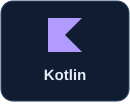
  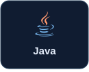
  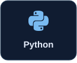
  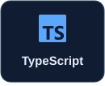
  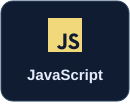
  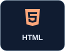
  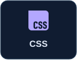

**Mobile &amp; desktop** &nbsp; Android · Compose · Kotlin Multiplatform · Ktor 
**Web &amp; APIs** &nbsp; React · Next.js · FastAPI · REST · WebSocket 
**Development** &nbsp; Git · GitHub · Gradle · Application packaging

Project stacks describe the team’s technology; contribution notes describe my own work.

## Hackathons &amp; credentials

<a href="certificates/hackalem-ai-2026-kasymbek-talasbek.pdf">
  
</a>

**HackAlem AI participant** · Astana, Kazakhstan · **November 1, 2026**

[View the original certificate (PDF) ↗](certificates/hackalem-ai-2026-kasymbek-talasbek.pdf)

Certificate preview &amp; event milestone

The participation certificate records the event’s Guinness World Records title: “Most Participants in an Agentic AI Hackathon”.

### Coursera

<a href="certificates/README.md">
  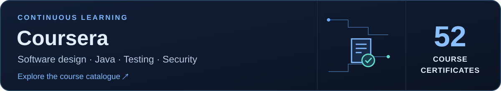
</a>

**[Driving Growth, Leadership, and Continuous Improvement ↗](https://www.coursera.org/account/accomplishments/verify/RVE17IID343O)** 
John Wiley &amp; Sons · October 31, 2026 · [Verify certificate](https://www.coursera.org/account/accomplishments/verify/RVE17IID343O)

View the Coursera certificate

<a href="https://www.coursera.org/account/accomplishments/verify/RVE17IID343O">
  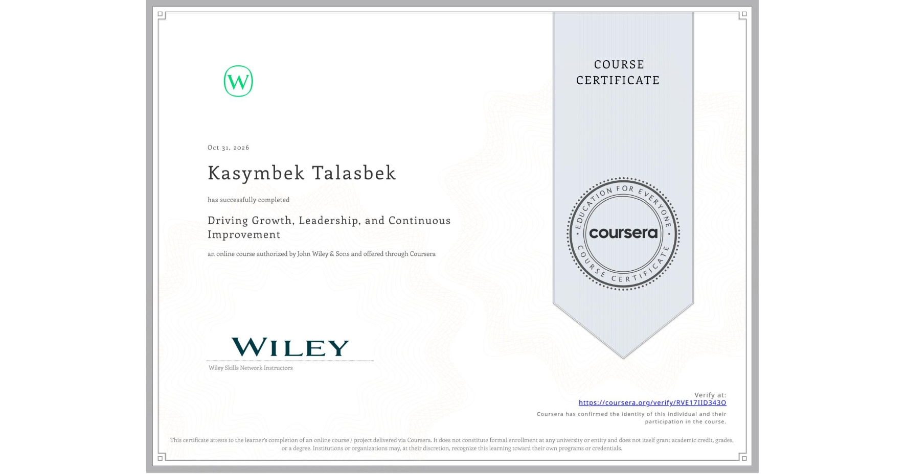
</a>

 

| Selected course certificates | Provider |
| --- | --- |
| Software Architecture · Design Patterns · Object-Oriented Design | University of Alberta |
| Mastering Java and Advanced Tools for Selenium Automation | Packt |
| Apply API Testing Fundamentals Using Postman | EDUCBA |
| Database Essentials and Vulnerabilities | IBM |

[Explore all 52 course certificates ↗](certificates/README.md)

 

---

  <strong>Let’s build something worth using.</strong> 
  <a href="https://www.linkedin.com/in/kasymbek-talasbek-7ba212378/">Start a conversation on LinkedIn ↗</a>

