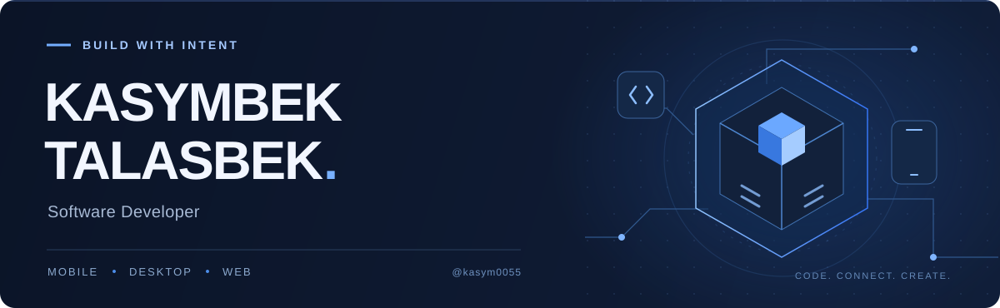
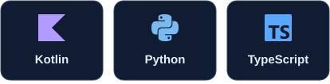
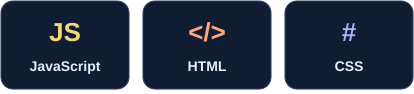
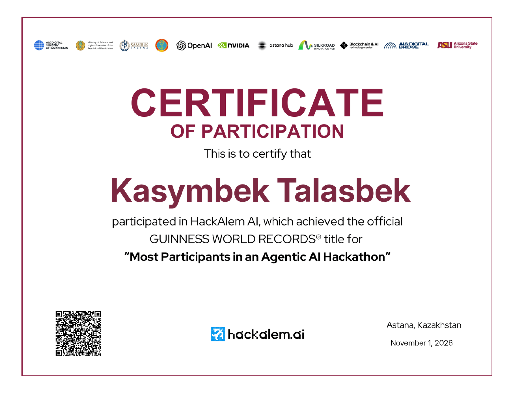

  

<h1 align="center">Building useful software.</h1>

<strong>Software Developer · Mobile &amp; Web · KDvibers</strong>

  I build applications across mobile, desktop and the web. 
  My work connects user interfaces, APIs and the details that make a product usable.

  <a href="https://www.linkedin.com/in/kasymbek-talasbek-7ba212378/"><strong>LinkedIn ↗</strong></a>
  &nbsp; · &nbsp;
  <a href="https://github.com/KDvibers"><strong>KDvibers ↗</strong></a>
  &nbsp; · &nbsp;
  <a href="#selected-work"><strong>Selected work ↓</strong></a>
  &nbsp; · &nbsp;
  <a href="#credentials"><strong>Credentials ↓</strong></a>

---

## A little about me

I'm **Kasymbek Talasbek**, a developer working with **Kotlin, Python and the TypeScript / JavaScript ecosystem**. With [KDvibers](https://github.com/KDvibers), I collaborate on applications for focused work, discovering hackathons and reviewing AI-generated findings.

I enjoy the work between a promising idea and a usable application: connecting screens to real data, handling application state, integrating APIs and preparing software for people to run.

## Selected work

### 01 &nbsp; [FocusDuo](https://github.com/KDvibers/FocusDuo)

**A shared rhythm for focused work.** A desktop application for two-person focus sessions, with a synchronized timer, individual goals and a shared session history.

- **My contribution:** desktop application work and packaging the Windows installer.
- **Project stack:** Kotlin · Compose Desktop · Java · Spring Boot · PostgreSQL · REST / WebSocket
- **Status:** Windows release **v0.1.0** available.

[Explore the code →](https://github.com/KDvibers/FocusDuo) &nbsp; · &nbsp; [Windows release →](https://github.com/KDvibers/FocusDuo/releases/tag/v0.1.0)

---

### 02 &nbsp; [HackAtlas](https://github.com/KDvibers/HackAtlas)

**Find your next hackathon.** A mobile catalogue with event details, bookmarks and registration links, built around a shared Kotlin Multiplatform client.

- **My contribution:** mobile client development, API and session integration, registration links and native sharing.
- **Project stack:** Kotlin Multiplatform · Compose Multiplatform · Java · Spring Boot
- **Status:** in development; Android tested, iOS validation pending.

[Explore the code →](https://github.com/KDvibers/HackAtlas)

---

### 03 &nbsp; [Forte Cash Audit](https://github.com/KDvibers/forte-cash-audit)

**From video to a reviewable report.** A KDvibers team project for a ForteBank hackathon case: upload a cash-operation video and inspect analysis results with timestamps and supporting frames.

- **My contribution:** frontend, results interface, application backend and deployment through Tailscale Funnel.
- **Project stack:** Python · FastAPI · JavaScript · HTML / CSS · Tailscale
- **Teamwork:** developed the application around the local video analyzer built by my teammate.

[Explore the code →](https://github.com/KDvibers/forte-cash-audit) &nbsp; · &nbsp; [Team contributions →](https://github.com/KDvibers/forte-cash-audit#team)

 

## Technologies I work with

  
  

**Mobile &amp; desktop** &nbsp; Android · Compose · Kotlin Multiplatform · Ktor

**Web &amp; APIs** &nbsp; React · Next.js · FastAPI · REST · WebSocket

**Development** &nbsp; Git · GitHub · Gradle · API integration · Application packaging

Each featured project's stack describes the team project; the contribution notes describe my own work.

## Learning &amp; credentials

### HackAlem AI — Participant

**Astana, Kazakhstan · November 1, 2026**

Participated in the HackAlem AI hackathon. The participation certificate identifies the event as the holder of the Guinness World Records title for “Most Participants in an Agentic AI Hackathon”.

[View participation certificate (PDF) →](certificates/hackalem-ai-2026-kasymbek-talasbek.pdf)

  
Preview the certificate

   
  

<!-- Coursera credentials: add exact course names, issuers and public verification links once supplied. -->

---

  <strong>Have an idea worth building?</strong> 
  <a href="https://www.linkedin.com/in/kasymbek-talasbek-7ba212378/">Let's connect on LinkedIn ↗</a>

