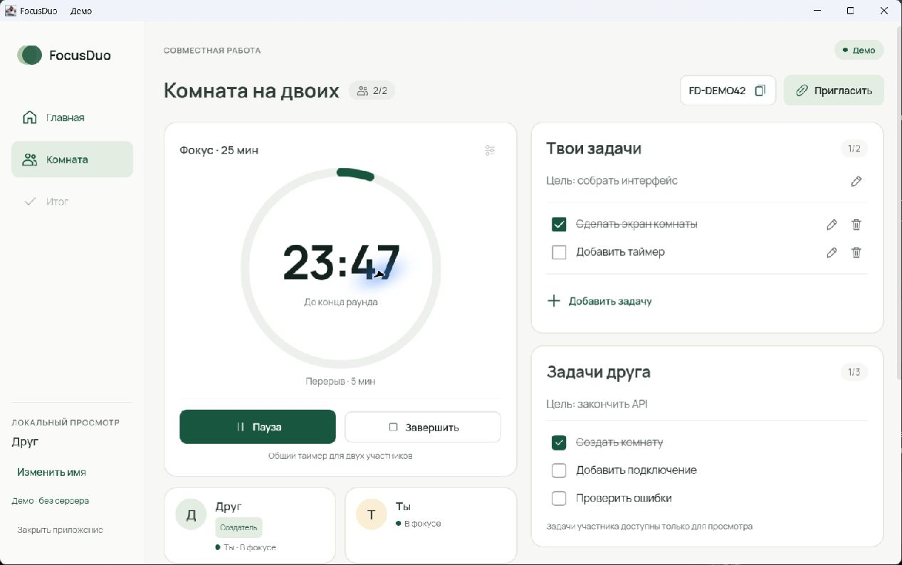
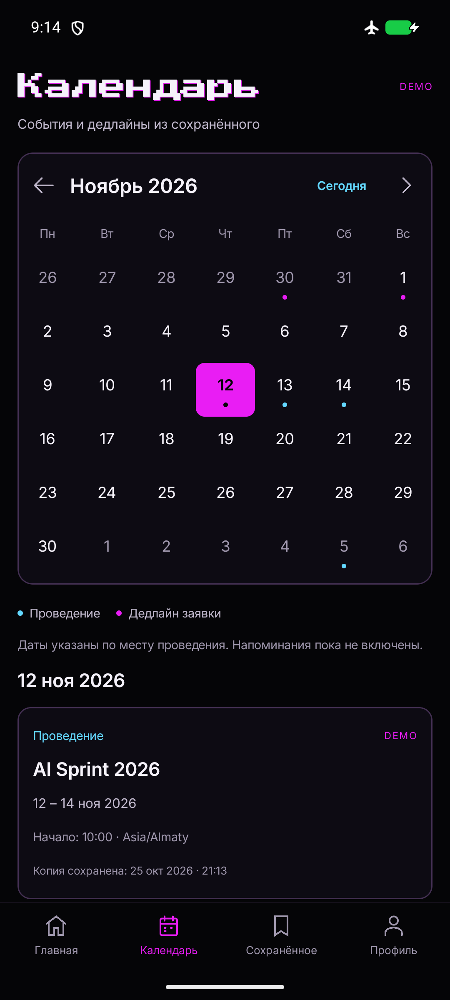

# Kasymbek Talasbek

Hi, I'm Kasymbek. I write Kotlin for Android and desktop with [KDvibers](https://github.com/KDvibers).

## A room in FocusDuo

In this demo, one person is building the interface while the other works on the API. Each has a task list, and the same 25-minute timer runs for both of them.

I worked on the desktop app and put together its Windows installer. [Source code](https://github.com/KDvibers/FocusDuo) · [Windows release](https://github.com/KDvibers/FocusDuo/releases/tag/v0.1.0) · [My installer commit](https://github.com/KDvibers/FocusDuo/commit/95e36d7e2c066152e538a72d0bb8f1501a556ece)

## Other projects

**[HackAtlas](https://github.com/KDvibers/HackAtlas)** helps you find hackathons and keep track of their deadlines. I connected the Kotlin Multiplatform app to our API and added registration links and sharing. You can send a hackathon to a teammate right from its event page.

A look at the HackAtlas calendar

**[Forte Cash Audit](https://github.com/KDvibers/forte-cash-audit)** grew out of a ForteBank hackathon case. A teammate wrote the video analyzer. I built the page that pairs each finding with its timestamp and video frame, and deployed it with the FastAPI backend I wrote.

## Tools I use

I work with Kotlin, Java and Compose on Android and desktop. For web projects I use TypeScript, JavaScript, HTML and CSS, often with React. For APIs I use Python and FastAPI.

I've also worked with **Supabase**, **Cloudflare** and **Firebase**.

- **Android Views and XML.** In [Playlist Maker's search screen](https://github.com/kasym0055/Playlist_Maker2/blob/0166548be2e7274dbdeacdee88231f29fcab83d7/app/src/main/java/com/example/playlist_maker2/SearchActivity.kt), I saved the search text and restored it when Android recreated the activity.
- **Ktor and Android Keystore.** I wrote the [HackAtlas session client](https://github.com/KDvibers/HackAtlas/commit/e9204c7fadda79991f8e171c7ae8167d822978df) with Ktor. On Android, it encrypts the saved token with a key from the Keystore.
- **Integration testing.** In my Next.js project, I wrote [Vitest tests for the Tavily search client](https://github.com/kasym0055/locus-hackathon/blob/0b53f165f5f4ebf3e8dc16b50930785544bc7091/tests/integration/tavily.test.ts) to check what happens when a request times out, gets cancelled or returns invalid data.
- **Packaging and deployment.** I used Gradle and PowerShell to [build the FocusDuo Windows installer](https://github.com/KDvibers/FocusDuo/commit/95e36d7e2c066152e538a72d0bb8f1501a556ece), and Tailscale Funnel to give the judges access to our [Forte Cash Audit demo](https://github.com/KDvibers/forte-cash-audit#team).

## Hackathons and courses

I took part in **HackAlem AI** in Astana on November 1, 2026. Here's my [participation certificate (PDF)](certificates/hackalem-ai-2026-kasymbek-talasbek.pdf).

I've kept a [list of my 52 Coursera course certificates](certificates/README.md). It includes *Design Patterns* from the University of Alberta and *Database Essentials and Vulnerabilities* from IBM. You can also [view my John Wiley & Sons certificate on Coursera](https://www.coursera.org/account/accomplishments/verify/RVE17IID343O).

[Find me on LinkedIn](https://www.linkedin.com/in/kasymbek-talasbek-7ba212378/)
