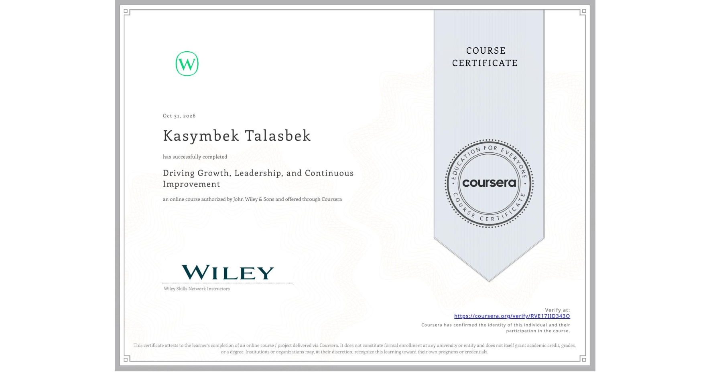

# Coursera certificates

These are the 52 courses I've completed on Coursera, grouped by subject.

[Back to my GitHub profile](https://github.com/kasym0055#hackathons-and-courses)

## Public certificate

**[Driving Growth, Leadership, and Continuous Improvement](https://www.coursera.org/account/accomplishments/verify/RVE17IID343O)** — John Wiley & Sons, October 31, 2026.

## Course list

The Wiley certificate above has a public verification link. The other 51 courses are listed by title and provider.

### Software design & delivery · 15

| Course | Provider |
| --- | --- |
| Agile Planning for Software Products | University of Alberta |
| Building Resilient Systems: Design for High Availability | STARWEAVER |
| Client Needs and Software Requirements | University of Alberta |
| Design Patterns | University of Alberta |
| Introduction to Software Product Management | University of Alberta |
| Object-Oriented Design | University of Alberta |
| Requirements Elicitation: Artifact and Stakeholder Analysis | University of Colorado System |
| Requirements Gathering for Secure Software Development | University of Colorado System |
| Requirements Specifications: Goals and Conflict Analysis | University of Colorado System |
| Reviews & Metrics for Software Improvements | University of Alberta |
| SRS Documents: Requirements and Diagrammatic Notations | University of Colorado System |
| Service-Oriented Architecture | University of Alberta |
| Software Architecture | University of Alberta |
| Software Processes and Agile Practices | University of Alberta |
| Software Requirements Prioritization: Risk Analysis | University of Colorado System |

### Java, testing & verification · 10

| Course | Provider |
| --- | --- |
| Advanced Selenium WebDriver Techniques and Framework Design | Packt |
| Apply API Testing Fundamentals Using Postman | EDUCBA |
| Black-box and White-box Testing | University of Minnesota |
| Foundations of Selenium WebDriver and Java for Automation | Packt |
| Introduction to Automated Analysis | University of Minnesota |
| Introduction to Software Testing | University of Minnesota |
| Mastering Java and Advanced Tools for Selenium Automation | Packt |
| Quantitative Model Checking | 28DIGITAL |
| Selenium Integration with CI/CD & Advanced Testing | Packt |
| Web and Mobile Testing with Selenium | University of Minnesota |

### Networks & cybersecurity · 9

| Course | Provider |
| --- | --- |
| CCNA Advanced – WAN, Security, and Network Services | Packt |
| CCNA Expert – Network Automation, Cloud, and Emerging Technologies | Packt |
| CCNA Foundations – Networking Basics and Cisco IOS Essentials | Packt |
| CCNA Intermediate – Switching, VLANs & Routing | Packt |
| Computer Networks and Network Security | IBM |
| Cybersecurity Compliance Framework, Standards & Regulations | IBM |
| Database Essentials and Vulnerabilities | IBM |
| Introduction to Cybersecurity Tools & Cyberattacks | IBM |
| Operating Systems: Overview, Administration, and Security | IBM |

### Business & broader learning · 18

| Course | Provider |
| --- | --- |
| Accounting: Principles of Financial Accounting | IESE Business School |
| Analysis of Business Problems | IESE Business School |
| Building Business Models and Financial Strategies | John Wiley & Sons |
| [Driving Growth, Leadership, and Continuous Improvement](https://www.coursera.org/account/accomplishments/verify/RVE17IID343O) | John Wiley & Sons |
| Ethics, Technology and Engineering | Eindhoven University of Technology, 4TU.Ethics |
| Finance for Managers | IESE Business School |
| Foundations of Effective Business Planning | John Wiley & Sons |
| International Business Context | University of Colorado Boulder |
| Introduction to Corporate Finance | University of Pennsylvania |
| Introduction to Financial Accounting | University of Pennsylvania |
| Introduction to Marketing | University of Pennsylvania |
| Introduction to Operations Management | University of Pennsylvania |
| Introduction to Process Safety and Risk Analysis | University of California, Davis |
| Managing Social and Human Capital | University of Pennsylvania |
| Marketing: Customer Needs and Wants | IESE Business School |
| Organizational Behavior: How to Manage People | IESE Business School |
| Wharton Business Foundations Capstone | University of Pennsylvania |
| Write Smarter with Overleaf and LaTeX | Fred Hutchinson Cancer Center |
